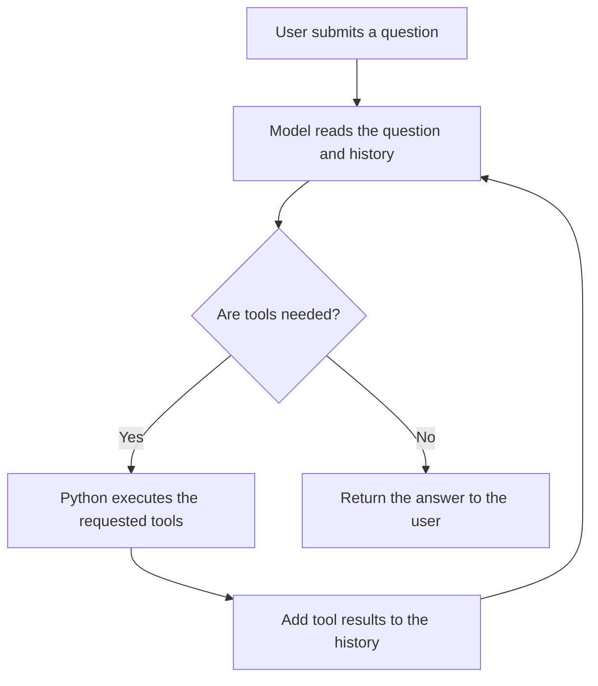
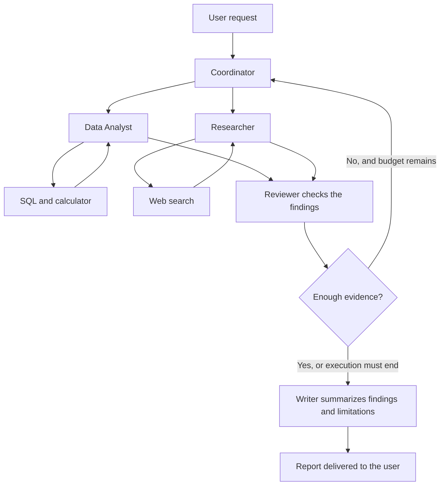

# Multi-Agent AI: From a Tool-Using Assistant to a Coordinated AI Team

A business question often involves several different tasks:

> “Which product generates the most revenue? What market trends should we consider? What should we do next?”

To answer with evidence, a system needs to read data, perform calculations, research external information, and turn its findings into recommendations. This is a useful setting for understanding AI agents and how they can evolve into a multi-agent system.

This article uses the Python AI Agent V2 project as a starting point. **The current project is a single agent with multiple tools, rather than a multi-agent system.** The diagrams below illustrate the existing code and a proposed extension. No reference image was available when this article was written.

## What Is an AI Agent?

In this article, an AI agent is a program that uses a language model to choose the next step toward completing a task. It can request a tool, inspect the result, and decide whether to continue or respond to the user.

For example, when asked about revenue, an agent can query a database instead of guessing a number.

A useful way to describe it is:

**Agent = language model + instructions + tools + context + execution loop.**

A tool performs a specific operation. The agent decides which operation is needed.

## How the Current Python Project Works

In this project, `agent.py` coordinates execution, while `tools.py` contains the local tool implementations. The agent has four available tools:

| Tool | Purpose |
|---|---|
| `calculator` | Evaluate arithmetic expressions |
| `query_sql` | Read sample sales data from SQLite |
| `current_utc_time` | Retrieve the current UTC date and time |
| `web_search` | Research information through a separate API request |

The execution flow looks like this:



Suppose the user asks:

> “Calculate revenue by product and identify the highest-revenue product.”

The model might request `query_sql` with this query:

```sql
SELECT
    product,
    SUM(quantity * unit_price) AS revenue
FROM sales
GROUP BY product
ORDER BY revenue DESC;
```

Python receives the request, executes the query, and sends the result back to the model. The model then uses the returned data to write its answer.

This is **function calling**: the model produces a structured request, the application executes the function, and the result is returned so the model can continue. See the [OpenAI function calling documentation](https://developers.openai.com/api/docs/guides/function-calling).

Several implementation details matter:

- The loop allows up to eight model calls. Each call can request multiple tools.
- Python executes the tools requested in each round sequentially.
- Conversation history stays in memory during the current run; there is no persistent conversation memory.
- SQLite contains sample data rather than live business records.

Although web search makes an additional API request, the overall design remains **one agent coordinating multiple tools**.

## What Makes a System Multi-Agent?

A multi-agent system divides work among agents with distinct roles and responsibilities.

For example:

| Agent | Responsibility | Available tools or inputs |
|---|---|---|
| Coordinator | Interpret the request and delegate work | Calls to specialist agents |
| Data Analyst | Analyze internal business data | SQL and calculator |
| Researcher | Find relevant market information | Web search |
| Reviewer | Check figures and supporting evidence | Query results and references |
| Writer | Produce a readable report | Reviewed findings |

These agents can use the same underlying model while receiving different instructions, context, and permissions. They can also run inside one Python application; each agent does not need its own server.

LangChain documents several coordination patterns, including subagents, handoffs, routers, and custom workflows. The appropriate pattern depends on the workflow and how context needs to be managed. See the [multi-agent documentation](https://docs.langchain.com/oss/python/langchain/multi-agent).

## How a Multi-Agent Architecture Would Work

For a report combining sales analysis and market research, the project could be extended as follows:



**This is a proposed extension, not functionality implemented in the current code.**

The Coordinator first identifies the required tasks. The Data Analyst retrieves internal figures, while the Researcher investigates external context. These branches can run in parallel when neither depends on the other's output.

The Reviewer checks whether calculations are correct, sources support the claims, and enough information exists to reach a conclusion. If evidence is missing, the system can perform another round within defined time and cost limits.

Finally, the Writer turns the findings into a report suited to the intended audience.

Adding a Reviewer does not guarantee correctness. Checks such as reconciling revenue totals, validating required fields, and detecting missing values should use deterministic code wherever practical.

## How Agents Exchange Information

In an implementation, agents typically communicate through function calls, APIs, or structured messages.

For example, the Data Analyst could return:

```json
{
  "task_id": "revenue-analysis",
  "status": "completed",
  "metric": "revenue",
  "source": "sample_sales_database",
  "findings": [
    {
      "product": "Laptop",
      "revenue": 6000
    }
  ],
  "limitations": [
    "Sample data only",
    "No date field for trend analysis"
  ]
}
```

The value `6000` is calculated from the sample rows declared in `tools.py`.

Structured messages help downstream agents understand where a finding came from and what its limitations are. This matters in the current project: the `sales` table has no transaction date, so it cannot support monthly growth analysis or identify when revenue started declining.

## Business Use Cases

The following examples are potential applications, rather than existing project features.

| Business problem | Possible division of work | Value and metrics to measure |
|---|---|---|
| Business reporting | Retrieve data, analyze, validate, write | Report preparation time and numerical error rate |
| Customer support | Retrieve order details, check policies, draft a response | Handling time and response correction rate |
| Market research | Collect sources, compare evidence, summarize | Source accuracy and research time |
| Invoice processing | Extract fields, match purchase orders, flag discrepancies | Match accuracy and discrepancies detected |
| Technical support | Read tickets, retrieve documentation, propose solutions | Resolution time and usefulness of suggestions |

In customer support, for example, one agent could have read access to order records while another searches return policies. The system combines their findings to propose a response.

For actions such as issuing refunds or modifying orders, the workflow should define execution permissions and approval requirements before deployment.

## The Technology Stack

The current project uses a small stack:

| Component | Technology in the project |
|---|---|
| Language | Python |
| Model access and tool calling | OpenAI Python SDK and Responses API |
| Data storage | SQLite |
| Configuration | `python-dotenv` |
| Arithmetic evaluation | Python AST |
| Interface | Command line |
| Testing | `unittest` |

This structure makes the agent loop easy to inspect: developers can see which tools the model requests and how their results are returned.

For a multi-user application, a possible architecture is:

```text
User interface
    |
    v
Backend with user authentication
    |
    v
Workflow orchestrator
    |
    v
Specialist agents
    |
    v
Permission-controlled tools and data sources
```

Python can remain the foundation, with additional components introduced as needed: an API backend, durable workflow state, background execution, and an interface for viewing reports.

For workflows that branch, preserve state, or pause for human review, LangGraph is one option to evaluate. Its documentation describes stateful agent orchestration, durable execution, and human-in-the-loop capabilities. See the [LangGraph overview](https://docs.langchain.com/oss/python/langgraph/overview).

There is no need to introduce every component immediately. A small workflow with measurable quality is a useful starting point.

## When Should You Use Multiple Agents?

Multiple agents are useful when tasks require meaningfully different instructions, tools, or access permissions. They can also help when independent research branches can run concurrently.

Coordination introduces costs, however: context transfer, additional model calls, error handling, and result aggregation. Several agents can also repeat the same incorrect assumption.

For a request such as “calculate revenue by product,” the existing single-agent design is a reasonable fit. For a report combining internal data, multiple research sources, and evidence review, separating responsibilities is worth evaluating.

## A Practical Next Step for This Project

A measurable development path is to keep the current version as a baseline, then experiment with two specialists: a Data Analyst and a Researcher. A Coordinator would delegate tasks, collect results, and synthesize the response.

Both versions should be evaluated against the same questions using answer accuracy, execution time, and cost per task. Add agents when the results demonstrate a clear benefit from dividing the work.

The value of multi-agent AI comes from task allocation, evidence sharing, and quality control. The number of agents is one design choice within that system.
